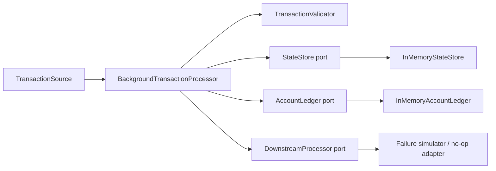

# Idempotent Background Transaction Processing Service

A Java 21 / Maven implementation of the FDE Level 2 practical assessment. The project focuses on safe background processing rather than a UI or a real queue/database.

## Requirements
- JDK 21+
- Maven 3.9+

## Run
```bash
mvn clean test
mvn -q package
mvn -q exec:java -Dexec.mainClass=com.fde.processor.ApplicationRunner
```

For a dependency-free classpath run after packaging, use Maven's exec plugin or run from your IDE. The console runner logs through SLF4J and prints a processing report.

## Architecture


- **Domain:** immutable transaction input, transaction state, statuses and processing summary.
- **Ports:** replaceable input, state, ledger and downstream boundaries.
- **Adapters:** in-memory implementations suitable for a local assessment.
- **Service:** validation, sequence coordination, retries, idempotency and audit reporting.

## Idempotency and duplicate detection
`requestId` identifies a delivery attempt; `transactionId` identifies the business effect. The state store atomically registers request IDs and claims transaction IDs. A repeated request ID or a new request ID for an already-registered business transaction is marked `DUPLICATE`; it does not reach the ledger. The ledger also keeps an applied-transaction guard as defense in depth.

## Ordering strategy
The processor starts each account at sequence 1. Future sequence numbers are buffered in a priority queue and processed when the missing sequence arrives. At the end of a batch, if an account has never processed any sequence, its smallest queued sequence is promoted to the baseline. This special rule supports the assessment's standalone `ACC-203 / seq=5` record, while `ACC-201 / seq=2` remains pending until `seq=1` arrives. If an account has already started and a later sequence is missing, the future record stays pending and the gap is reported.

This is a deliberately simple batch-window policy, not a universal ordering rule. A production queue consumer should define an explicit per-account starting offset or checkpoint and a timeout/DLQ policy for permanent gaps.

## Retry and consistency
The downstream adapter runs before the ledger mutation. A simulated transient failure can therefore be retried without a partial balance change. The maximum retry count is configurable; `maxRetries=2` means up to three total attempts. The ledger uses a per-account `ReentrantLock` to make balance checks and updates atomic. A debit that would make the balance negative fails. The demo treats `REVERSAL` as a credit; production reversal logic must reference the original transaction and prevent multiple reversals.

## Observability and data handling
Every delivery attempt gets a status result, and the summary contains counts, balances, audit results and sequence gaps. Account identifiers are masked in application logs. The in-memory store and ledger are process-local and lose data on restart; they are not a production persistence strategy.

## Sample run result
The included CLI demo produces these business outcomes (log timestamps and map display order can vary):

| Request | Final status | Attempts | Result |
|---|---|---:|---|
| `REQ-1` | `PROCESSED` | 1 | Credit 100 to `ACC-201` |
| `REQ-2` | `PROCESSED` | 1 | Debit 40 after sequence 1 |
| `REQ-2-DUP` | `DUPLICATE` | 0 | No second debit |
| `REQ-3` | `PROCESSED` | 1 | Credit 25 |
| `REQ-4` | `FAILED` | 0 | Negative amount rejected |
| `REQ-5` | `PROCESSED` | 2 | One simulated transient failure, then success |

Final balances: `ACC-201 = 85`, `ACC-203 = 500`; `ACC-202 = 0`. The CSV sample is in `sample-transactions.csv` (the CLI currently constructs the same sample directly so it has no external file dependency).

## Tests
The JUnit 5 test suite covers the supplied six-row scenario, business/request duplicates, a missing sequence, transient retry exhaustion, invalid input isolation, account masking, and concurrent duplicate submissions.

## AI-assisted development reflection
AI can speed up scaffolding, test-case generation and documentation. The engineer remains responsible for reviewing generated logic, running tests, checking concurrency/idempotency assumptions and explaining the sequence-baseline trade-off. Do not claim the project is production-ready: it uses in-memory persistence and a batch-level coordinator lock.

## Production hardening roadmap
1. Replace in-memory adapters with PostgreSQL transactions and unique constraints (`transaction_id`, `request_id`) plus atomic ledger writes.
2. Partition queue messages by `accountId`; use database locking or optimistic version checks across service instances.
3. Persist retries and add exponential backoff, a dead-letter queue, and operator replay tooling.
4. Add metrics/tracing with Micrometer/OpenTelemetry and health checks.
5. Add authentication, authorization, currency/account policies, and an auditable reversal model.
